Gitverse
============

.. contents:: Содержание
   :local:
   :depth: 2

1. Заходим по ссылке: `<https://gitverse.ru/>`_
2. Шаблон репозитория ППС: `<https://gitverse.ru/KAA85/reverse-engineering-demo>`_
3. Инструкция по работе с репозитрием: `инструкция <https://gitverse.ru/KAA85/reverse-engineering-demo/content/master/инструкция-по-работе-с-репозиторием-ППС.md>`_

Регистрация
---------------------

1) Нажимаем ``Начать работу``:

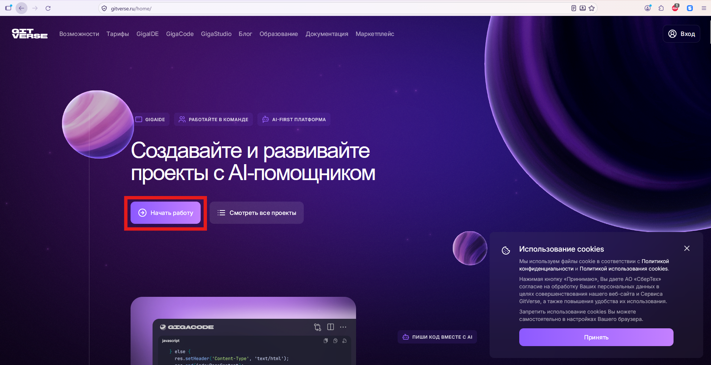

   Страница регистрации.

2) Войти по ``GigaID``:

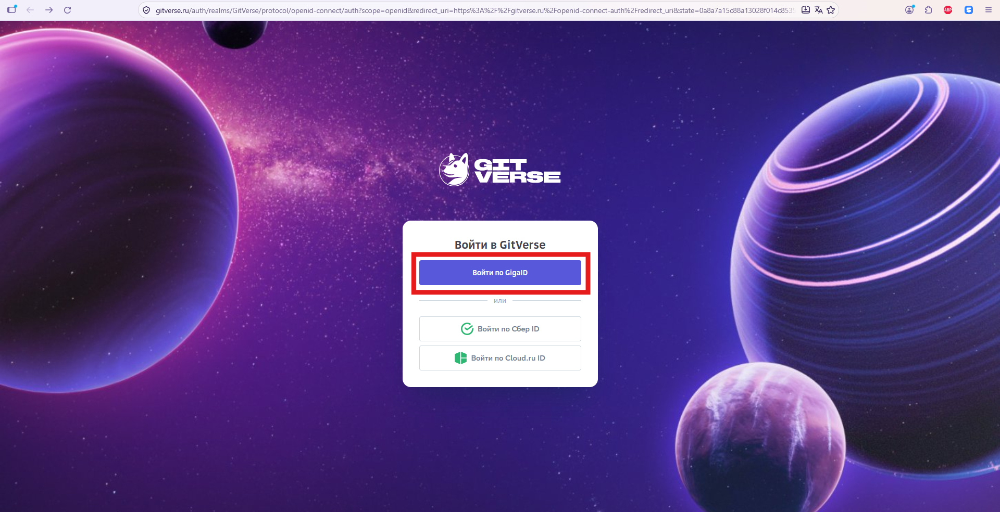

   Регистрируемся при помощи GigaID.

3) Если у Вас нет учетной записи - ``Создать GigaID``:

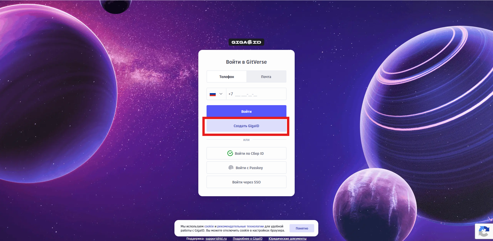

   Создать GigaID.

4) Пример регистрации по почтовому адресу **СибГУТИ** (если нет, идем в **ОИТ** и получаем):

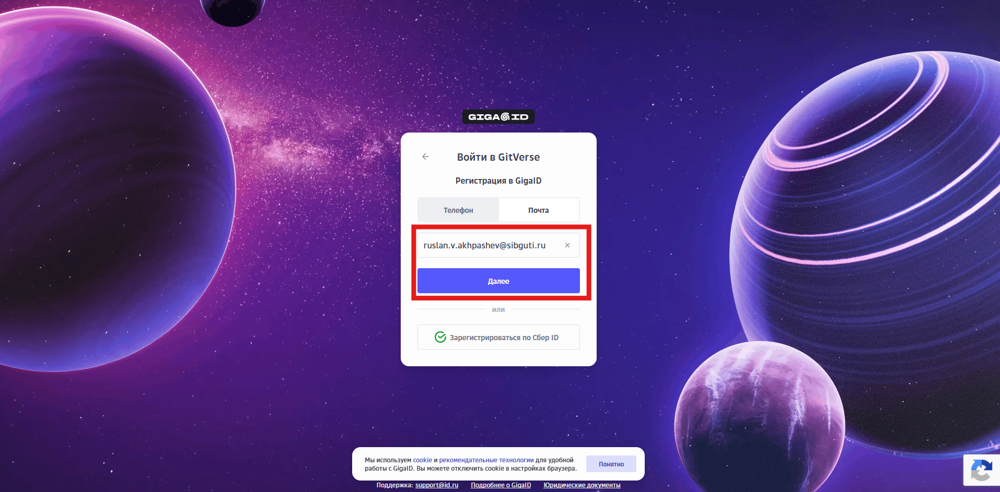

   Регистрация по почте СибГУТИ.

5) На почту придет ``Код подтверждения``, вводим:

   Код подтверждения на почту.

6) Далее, попросит привязать номер телефона:

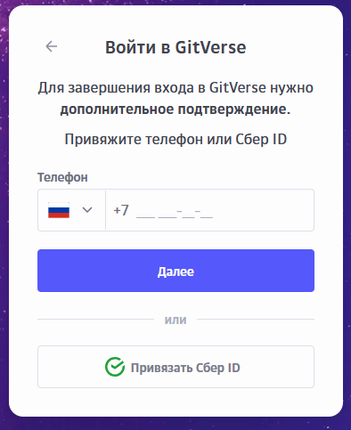

   Привязываем номер телефона.

7) Придет **СМС** с кодом подтверждения, вводим:

   Код подтверждения СМСкой.

8) Придумать имя пользователя ``Girverse``:

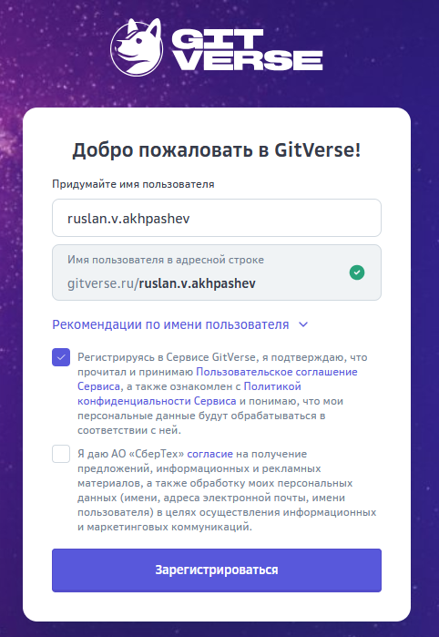

   Придумать имя пользователя.

9) Вуаля, создали учетную запись:

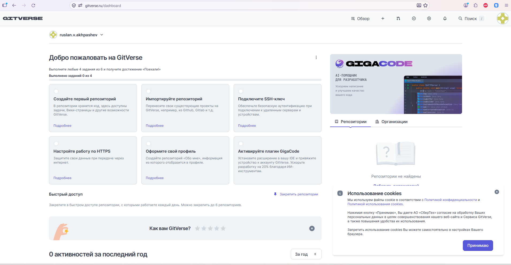

   Готово.

Создание публичного репозитория в Gitverse
---------------------

Есть **2 варианта** по созданию репозитория для оформления РПД и пр.:

- Пример с использованием готового `шаблона <https://gitverse.ru/KAA85/reverse-engineering-demo/content/master/%D0%B8%D0%BD%D1%81%D1%82%D1%80%D1%83%D0%BA%D1%86%D0%B8%D1%8F-%D0%BF%D0%BE-%D1%80%D0%B0%D0%B1%D0%BE%D1%82%D0%B5-%D1%81-%D1%80%D0%B5%D0%BF%D0%BE%D0%B7%D0%B8%D1%82%D0%BE%D1%80%D0%B8%D0%B5%D0%BC-%D0%9F%D0%9F%D0%A1.md>`_;
- Создаем репозитрий с нуля (читаем ниже).

**Репозитрий с нуля**:

1) Нажимаем на кнопку **создания первого репозитория**:

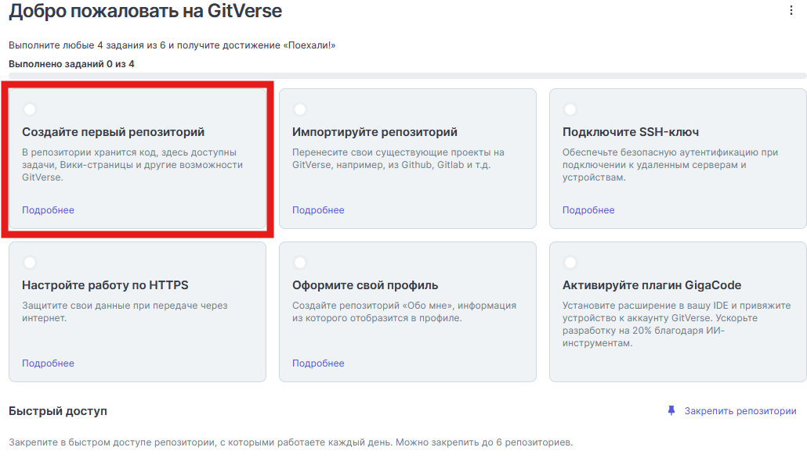

   Создать репозитрий.

2) Заполняем название Вашего репозитория, его видимость (пиватность) и т.д.:

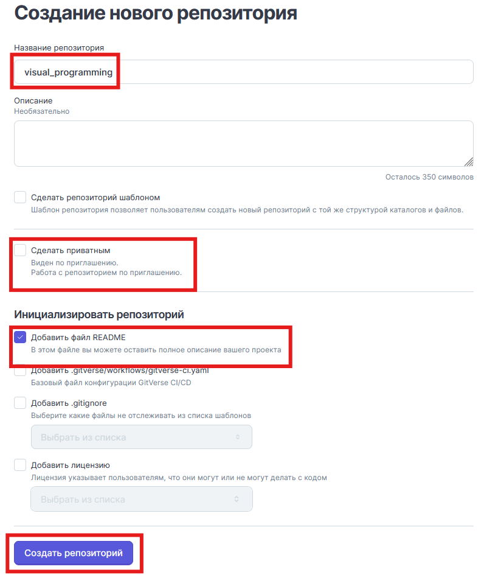

   Создание репозитория.

Файл ``README.md`` обычно представляет из себя обчыный текстовый файл, в котором описывают проект. Этот файл автоматически будет отображаться при переходе на Ваш проект.

3) Репозиторий успешно создан. Сейчас в нем присутствует лишь 1 файл: ``README.md``, его содержимое отображается как описание вашего проекта.

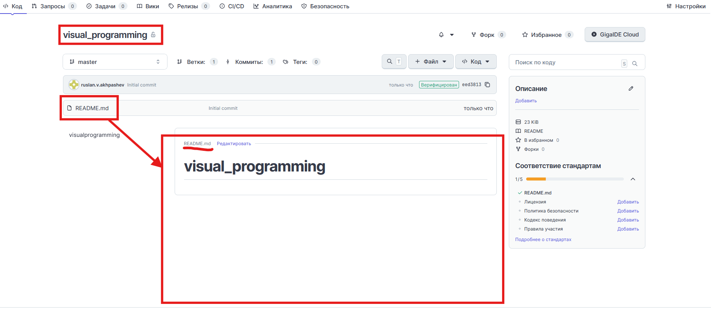

   Репозиторий создан.

Добавление файлов в репозиторий
---------------------

1) Шаблон репозитория ППС: `<https://gitverse.ru/KAA85/reverse-engineering-demo>`_

В этом шаблоне уже есть готовый пример работ РПД, ОС и т.д в формате ``.md``. Скачать его можно по ссылке выше: 

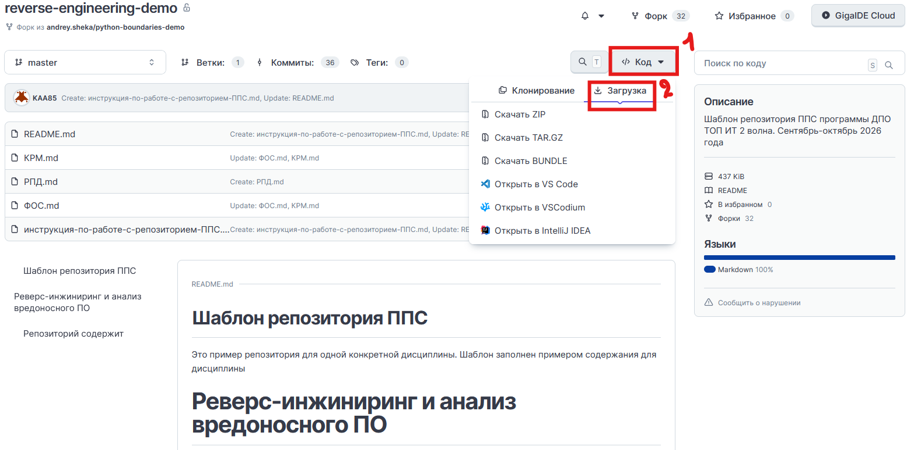

   Репозиторий создан.

2) После скачивания архива с репозитрием можно посмотреть на внутренности файлов формата ``MARKDOWN`` или ``.md``:

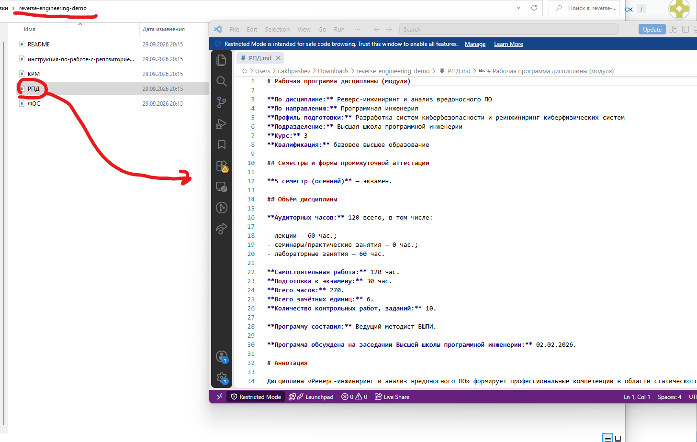

   Формат ``markdown``.

Примеры оформлений ``.md`` (можно открывать в ``VsCode``, ``Блокнот``, ``Онлайн-редакторах``): 

- `Онлайн редактор <https://markdownlivepreview.com/>`_
- `Офлан гайд <https://gist.github.com/Jekins/2bf2d0638163f1294637>`_
- `Еще один гайд <https://doka.guide/tools/markdown/>`_

Важно помнить, что файлы сохраняются именно в формате ``<имя_файла>.md``.

3) Загружаем измененные файлы в Ваш репозиторий. Сначала находим кнопку ``Загрузить файл`` в Вашем репозитории: 

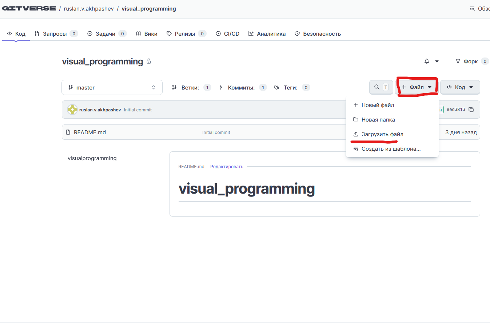

   Загрузить файл.

**Далее**, загружаю файл с названием ``test.md``:

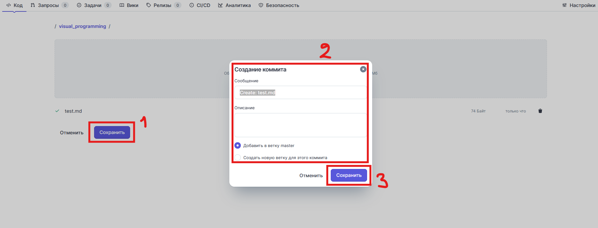

   Сохранить.

Коментарии к коммиту и его описание можно заполнять по желанию.

По умолчанию, ветка используется - ``master``.

**Готово**, файл успешно загружен.

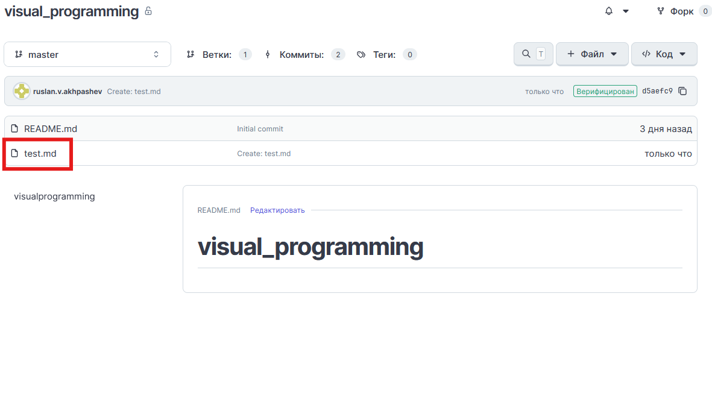

   Готово.

После открытия файла Вы уже будете видеть отформатированный текст, без спец. знаков разметки: 

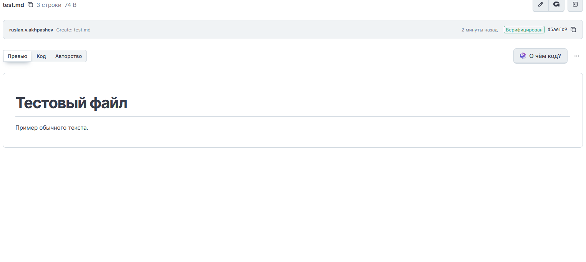

   Результат.